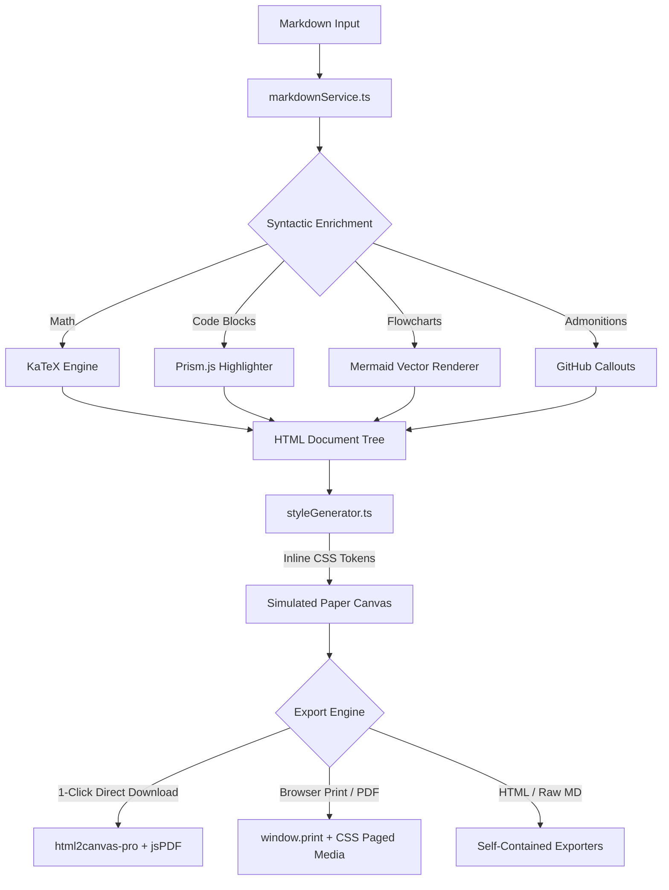
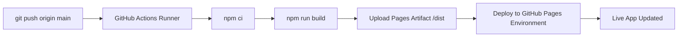

# AI Coding Agent & Contributor Guidelines 🤖

> This document establishes the engineering principles, architectural patterns, coding conventions, and automated workflows for AI agents and human contributors working on the **Markdown to PDF Studio** codebase.

<!-- AUTO-GEN-META:START -->
- **Latest Verified Commit**: `ba9ae50` (2026-10-15)
- **Active Branch**: `main`
- **Total Source Files**: `18`
- **Unit & Integration Tests**: `16 passed`
<!-- AUTO-GEN-META:END -->

---

## 🏗️ 1. Architecture Overview

Markdown to PDF Studio is built around a pure **Client-Side Document Typesetting Pipeline**:



### Core Architecture Components:

1. **Markdown Processor** ([`src/services/markdownService.ts`](file:///home/client/markdowntodf/markdowntopdf/src/services/markdownService.ts)):
   - Fast GFM parsing with custom Marked extensions.
   - Equation parsing via KaTeX (`$...$` inline and `$$...$$` display mode).
   - Prism.js code cards with macOS-style window controls.
   - Auto-detection and auto-fencing of unfenced flowcharts (`autoFenceMermaid`).
   - Resilient syntax sanitization (`sanitizeMermaidCode`) to prevent parse errors.

2. **Inline Style Generator** ([`src/services/styleGenerator.ts`](file:///home/client/markdowntodf/markdowntopdf/src/services/styleGenerator.ts)):
   - **Zero external CSS files for themes or print**: all tokens are computed dynamically in JavaScript and injected as an inline `<style>` tag.
   - Supports 5 typography themes: `academic`, `executive`, `tech`, `editorial`, `minimal`.
   - Comprehensive `@media print` rules ensuring exact color adjustments (`-webkit-print-color-adjust: exact !important`), page geometry, headers/footers, and page breaks.

3. **Dual PDF Engine** ([`src/services/pdfService.ts`](file:///home/client/markdowntodf/markdowntopdf/src/services/pdfService.ts)):
   - **Vector Print Engine**: Uses `window.print()` with CSS Paged Media `@page { size: ...; margin: ...; }`.
   - **Direct PDF Generator**: Uses `html2canvas-pro` + `jsPDF` with:
     - High-resolution SVG-to-Canvas rasterization bridge (`rasterizeSvgElements`).
     - Dynamic canvas scale calculation to prevent exceeding browser canvas memory limits (16,384px height).
     - Accurate multi-page canvas slicing and verified `.pdf` file naming.

4. **Live Paper Canvas Preview** ([`src/components/preview/MarkdownPreview.tsx`](file:///home/client/markdowntodf/markdowntopdf/src/components/preview/MarkdownPreview.tsx)):
   - A4, US Letter, Legal, and A5 aspect ratios with realistic shadows and margins.
   - Interactive zoom controls (50% to 175%).
   - Reactive Mermaid SVG rendering with `htmlLabels: false` for pure SVG output.

---

## 📐 2. Coding Standards & Conventions

Every contribution must follow these rules without exception:

### 2.1 Naming Conventions
- **Variables & Functions**: `camelCase` (e.g. `renderMarkdown`, `downloadDirectPdf`, `sheetWidthMm`).
- **React Components**: `PascalCase` (e.g. `MarkdownEditor`, `MarkdownPreview`, `Header`).
- **Constants**: `UPPER_SNAKE_CASE` (e.g. `PAGE_SIZES`, `MARGIN_VALUES_MM`).
- **Files**:
  - Components: `PascalCase.tsx`
  - Services & Utilities: `camelCase.ts`
  - Types: `camelCase.ts` or `document.ts`

### 2.2 Styling Constraints
- **Do NOT introduce external `.css` files for themes or print**.
- All document themes, margins, paper sizing, and print rules MUST remain within [`src/services/styleGenerator.ts`](file:///home/client/markdowntodf/markdowntopdf/src/services/styleGenerator.ts).
- Application UI styles use Tailwind CSS v4 utility classes.

### 2.3 SVG & Print Rules
- In `@media print`, **never** apply `transform: none !important` to universal selectors (`*`). SVG elements rely on `transform="translate(x, y)"` for node and label placement.
- Restrict `transform: none !important` exclusively to `.paper-sheet-zoom-wrapper`.
- Always set `print-color-adjust: exact !important` and `-webkit-print-color-adjust: exact !important` on SVG elements and containers.

### 2.4 Testing Requirement
- Write unit tests for new services and utility functions in `src/services/__tests__/`.
- Run `npm test` before committing. All tests must pass with 0 failures.

---

## 🚀 3. GitHub Pages Automated CI/CD Workflow

The repository is configured to automatically build and deploy to **GitHub Pages** via GitHub Actions whenever changes are pushed to `main`.

### Workflow File: [`.github/workflows/deploy.yml`](file:///home/client/markdowntodf/markdowntopdf/.github/workflows/deploy.yml)



### How to Commit & Trigger Auto-Deployment:

To update the application and deploy your changes automatically:

```bash
# 1. Verify tests and build pass locally
npm test
npm run build

# 2. Update documentation metadata (runs automated doc agent)
npm run update-docs

# 3. Stage and commit your changes
git add .
git commit -m "feat: description of your change"

# 4. Push to main (triggers GitHub Pages deployment)
git push origin main
```

Within 60-90 seconds, GitHub Actions completes the build and the live site at **[yashpimpalkar.github.io/markdowntopdf/](https://yashpimpalkar.github.io/markdowntopdf/)** is updated.

---

## 🤖 4. Automated Documentation Agent

The script [`scripts/auto_doc_updater.js`](file:///home/client/markdowntodf/markdowntopdf/scripts/auto_doc_updater.js) acts as an autonomous agent that keeps `README.md` and `AGENTS.md` in sync with the codebase.

### What the Documentation Agent Does:
1. Gathers current git branch, commit hash, and commit timestamp.
2. Runs the test suite via Vitest to record passing test counts.
3. Recursively counts all active source files in `src/`.
4. Injects updated badges into `README.md` and metadata into `AGENTS.md`.

Run it anytime with:
```bash
npm run update-docs
```
