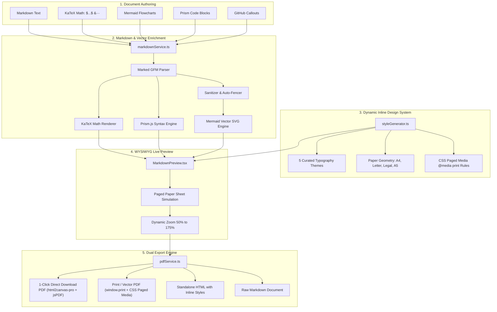

# Markdown to PDF Studio 📄✨

> Transform raw Markdown into publication-grade, beautifully typeset PDF documents with live A4/Letter paper simulation, mathematical formulas, syntax-highlighted code cards, interactive Mermaid flowcharts, and curated typography themes.

<!-- AUTO-GEN-STATS:START -->
[]()
[]()
[]()
<!-- AUTO-GEN-STATS:END -->
[](https://github.com/YashPimpalkar/markdowntopdf/actions/workflows/deploy.yml)
[](https://yashpimpalkar.github.io/markdowntopdf/)
[](LICENSE)

---

## 🌐 Live Web App

Try the live studio without installing anything:
👉 **[yashpimpalkar.github.io/markdowntopdf](https://yashpimpalkar.github.io/markdowntopdf/)**

---

## 🏛️ System Architecture

Markdown to PDF Studio uses a high-performance, client-side typesetting pipeline that transforms Markdown text into responsive vector graphics and multi-page PDFs with zero backend dependencies:



---

## 🌟 Key Features

- **Live Split-Pane Studio**: Side-by-side editing with synchronized preview, resizable divider, and line numbers.
- **WYSIWYG Paged Paper Simulation**: Realistic A4, US Letter, Legal, and A5 canvas with shadows, margins, and page-break markers (`<!-- pagebreak -->`).
- **Mermaid Flowchart Engine**:
  - Full vector SVG diagram rendering for `flowchart TD`, `flowchart LR`, `graph`, decision diamonds, loops, and subgraphs.
  - Automatic detection of unfenced diagrams (`autoFenceMermaid`).
  - Resilient syntax sanitization (`sanitizeMermaidCode`) to prevent parse errors.
  - Support for `classDef` custom styling and color classification.
- **Dual PDF Engine**:
  - **1-Click Direct Download**: Multi-page PDF generation via `html2canvas-pro` + `jsPDF` with high-resolution SVG-to-Canvas rasterization and dynamic canvas scaling.
  - **Print / Vector PDF**: High-resolution browser print engine (`window.print()`) with selectable text, active hyperlinks, preserved SVG transforms, and CSS Paged Media.
- **5 Curated Typography Themes**:
  - 🛠️ **Tech & Dev**: Indigo accents with JetBrains Mono code cards.
  - 💼 **Executive Report**: Deep navy headings with warm gold metrics.
  - 🎓 **Academic & Research**: Merriweather serif with Oxford blue citations.
  - 📖 **Editorial / Book**: Playfair Display with literary crimson accents.
  - 🌿 **Swiss Minimal**: High-contrast monochrome with emerald touches.
- **Mathematical Formulas**: Full LaTeX / KaTeX rendering ($...$ and $$...$$).
- **Code Syntax Highlighting**: Prism.js highlighting with macOS-style window controls and language tags.
- **GitHub Callouts**: Styled admonition boxes (`[!NOTE]`, `[!TIP]`, `[!WARNING]`, `[!CAUTION]`).
- **Starter Templates**: Pre-loaded Technical Specifications, Executive Reports, Academic Papers, and Modern Resumes.
- **Zero External CSS Theme Files**: All document styles are computed dynamically in JavaScript and applied as inline CSS.

---

## 🚀 How to Commit for Automatic GitHub Pages Deployment

The repository uses **GitHub Actions** (`.github/workflows/deploy.yml`) to automatically build and deploy the app to GitHub Pages whenever code is pushed to the `main` branch.

### Step-by-Step Auto-Deploy Guide:

```bash
# 1. Check working directory status
git status

# 2. Run test suite to verify all unit & integration tests pass
npm test

# 3. Verify production bundle builds cleanly
npm run build

# 4. Run the automated documentation agent (updates README & AGENTS stats)
npm run update-docs

# 5. Stage modified files
git add .

# 6. Commit your changes with a clear message
git commit -m "feat: add new feature description"

# 7. Push to the main branch
git push origin main
```

### What Happens Automatically:
1. GitHub receives the push on branch `main`.
2. The GitHub Actions workflow **"Deploy to GitHub Pages"** is automatically triggered.
3. The workflow runs `npm ci` and `npm run build`.
4. The compiled production bundle in `dist/` is packaged and published to GitHub Pages.
5. In **60–90 seconds**, the live app is updated at:
   👉 **`https://yashpimpalkar.github.io/markdowntopdf/`**

---

## 📊 Flowchart Support Examples

You can enter diagrams in standard fenced blocks or unfenced Markdown:

```markdown
flowchart TD
    A([Start]) --> B[Open Website]
    B --> C[Enter Markdown]
    C --> D[Click Convert to PDF]
    D --> E{Conversion Successful?}
    E -->|Yes| F[Download PDF]
    E -->|No| G[Display Error]
    F --> H([End])
    G --> C

    classDef success fill:#dcfce7,stroke:#16a34a,color:#14532d;
    class F success;
```

---

## 🤖 Automated Documentation Agent

The repository includes an autonomous documentation sync agent in [`scripts/auto_doc_updater.js`](file:///home/client/markdowntodf/markdowntopdf/scripts/auto_doc_updater.js).

When executed, it:
1. Gathers current git branch, commit hash, and commit date.
2. Runs the test suite via Vitest and counts passing tests.
3. Counts all active source files in `src/`.
4. Automatically updates the statistics badges in `README.md` and metadata in `AGENTS.md`.

Run it manually anytime:
```bash
npm run update-docs
```

---

## 💻 Local Development

### Prerequisites
- Node.js 20+
- npm 10+

### Setup
```bash
git clone https://github.com/YashPimpalkar/markdowntopdf.git
cd markdowntopdf
npm install
```

### Development Server
```bash
npm run dev
```

### Run Tests
```bash
npm test
```

### Production Build
```bash
npm run build
```

---

## 📄 License

MIT © [Yash Pimpalkar](https://github.com/YashPimpalkar)
